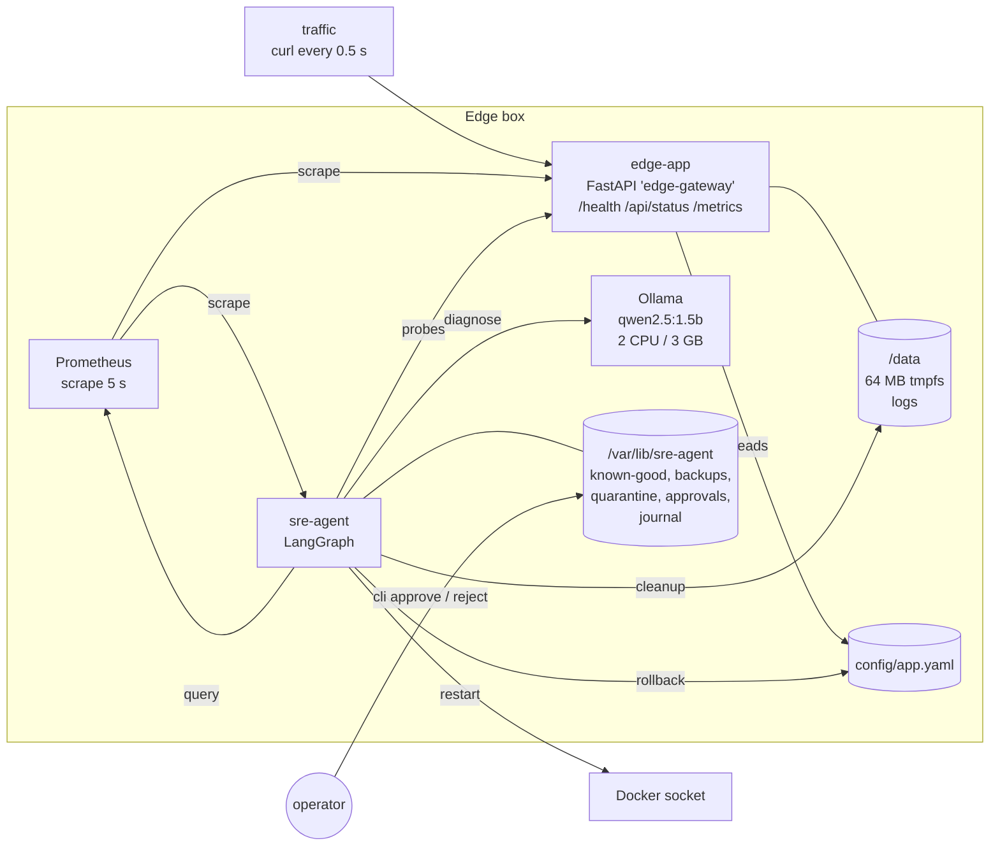
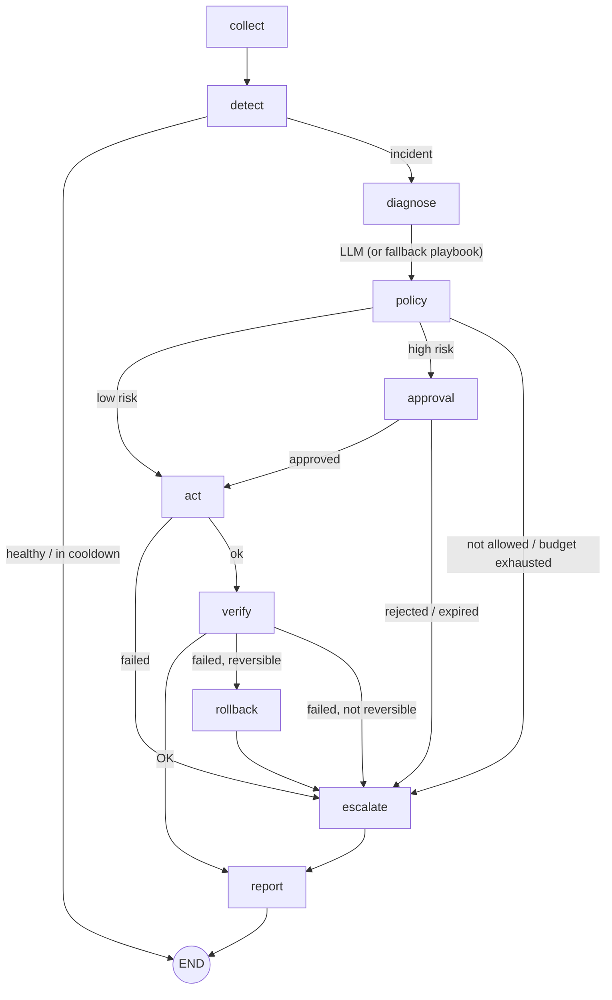

# local-sre-agent

An autonomous SRE agent that runs **locally on an edge box, with no cloud**. It monitors the services of a Linux
machine, detects incidents (service stopped, disk full, abnormal latency), asks a **local LLM** for a diagnosis,
and fixes the problem itself through a small set of authorized actions, with verification after every fix,
rollback on failure and human validation of risky actions.

Stack: Python, LangGraph, Ollama (`qwen2.5:1.5b`), Prometheus, Docker Compose, Linux.

> **Status: work in progress.** Portfolio / study project, not production software.

## The problem

Edge devices (gateways, kiosks, industrial boxes) run far from any operator, often with poor or no connectivity.
When a service stops at 3 a.m. or a disk fills up, nobody is there, and sending logs to a cloud LLM is not an
option (connectivity, cost, data privacy). The question this project explores:

*Can a small model running on the box itself help remediate common incidents **safely**?*

The answer here is "yes, if the LLM is only one advisor inside a deterministic safety frame": detection, policy,
verification and rollback are plain code; the LLM only picks among pre-approved actions.

## Architecture

Everything runs on one machine with Docker Compose.



| Service | Role |
|---|---|
| `edge-app` | The service on the box. Reads `config/app.yaml` on each request (cached on mtime); `latency_ms` adds a sleep, which is how a bad config push causes abnormal latency. Rotating logs on a 64 MB tmpfs volume. `restart: "no"`: recovery is the agent's job. |
| `traffic` | Calls `/api/status` every 0.5 s so latency metrics exist. |
| `prometheus` | Scrapes the app and the agent every 5 s. |
| `ollama` + `ollama-pull` | Local LLM server, limited to 2 CPUs / 3 GB to mimic edge hardware; one-shot model download. |
| `agent` | The SRE agent (`agent/sre_agent`). Metrics on `:9200`. |

## Agent flow

One LangGraph invocation = one cycle, every 10 s.



| Node | What it does |
|---|---|
| **collect** | Queries Prometheus: `up`, p95 latency of `/api/status` over 30 s, disk usage. If Prometheus is down, degrades to direct HTTP probes + local disk usage. |
| **detect** | Deterministic thresholds, **no LLM**: `service_down` (severity 1), `high_latency` p95 > 500 ms (only if up), `disk_full` ≥ 85 % (severity 1 if ≥ 95 %). The most severe incident not in cooldown is handled. |
| **diagnose** | Asks Ollama for `{reason, action, confidence}`. Any timeout, invalid JSON or non-allowed action → fixed playbook (`decided_by: fallback`). |
| **policy** | *The LLM proposes, the policy decides*: allowlist, risk level, restart budget. |
| **approval** | High-risk action → a JSON request file; an operator approves or rejects with the CLI. No answer in 300 s = expired = **not executed**. |
| **act** | Runs the action. Each action returns `ActionResult(ok, detail, undo)`. |
| **verify** | Direct probes (not Prometheus): health 200, plus disk < 85 % or median latency of 3 requests < 500 ms. Up to 6 attempts, 5 s apart. |
| **rollback** | If verification fails and the action is reversible, run its `undo`. |
| **escalate** | Logs at ERROR level, sets a 10 min cooldown on that incident type. |
| **report** | Appends a JSON record to `incidents.jsonl` (incident, snapshot, decision, policy, approval, result, verification, rollback, outcome, timeline) and updates the agent metrics. |

## Safety model

| Incident | Allowed actions | Risk | Reversible | Human approval |
|---|---|---|---|---|
| `service_down` | `restart_service`, `escalate` | low | no | no |
| `disk_full` | `cleanup_logs`, `escalate` | low | yes (files moved back) | no |
| `high_latency` | `rollback_config`, `restart_service`, `escalate` | **high** / low | yes (backup restored) | **yes** for `rollback_config` |

Other guard rails:

- **Restart budget**: max 3 restarts per 10 min, then escalate (no restart loops).
- **Escalation cooldown**: 10 min per incident type, so the agent does not hammer a problem it cannot fix.
- **Settle time**: after a successful fix, the same incident type is ignored for 45 s, because Prometheus' 30 s
  rate window still shows the old latency and the agent would otherwise "fix" a problem that is already gone.
- **Verify, then roll back**: an action that "succeeded" but did not fix the symptom is undone when possible.
- **Safe defaults**: approval timeout = not executed; `DRY_RUN=true` logs what would be done and changes nothing.
- **Bounded actions**: cleanup never touches the live `app.log`; config rollback refuses if there is no known-good
  config or if the current config already equals it ("the cause is elsewhere").
- **Crash isolation**: an exception in a cycle or in an action is logged, never kills the loop.

## Quick start

Requirements: Docker with Compose v2, ~3 GB of disk (Ollama image + model), Python 3.11+ for the tests.

```bash
make up          # build and start (first run downloads the model, ~1 GB)
make logs        # follow the agent decisions (another terminal)
make status      # app health, latency, disk, Prometheus view
make test        # 35 unit + graph tests, no Docker needed
```

The edge-app is published on `localhost:18080` (`EDGE_PORT`), Prometheus on `localhost:9090`.
Copy `.env.example` to `.env` to change settings.

Wait ~60 s after start: the current config must soak (6 healthy cycles) before it becomes **known-good**:

```
INFO    [llm] qwen2.5:1.5b loaded in 1.5s
INFO    [known-good] config promoted to known-good after 6 healthy cycles
```

## Demo scenarios

Real output, recorded on a 16-core laptop with Ollama limited to 2 CPUs. Run `make reset` between scenarios
(it repairs everything with the agent stopped, waits for metrics to settle, and clears cooldowns).

### 1. Service stopped → restart

```bash
make service-down      # docker stop edge-app
```

```
WARNING [detect] service_down (severity 1): edge-app is not up (source=prometheus)
INFO    [llm] qwen2.5:1.5b answered in 8.4s
INFO    [diagnose] llm proposes restart_service (confidence 0.80): The service is not up, and there are no changes to the configuration or logs that suggest an immediate fix.
INFO    [policy] restart_service: allowed, low risk
INFO    [act] restart_service -> ok: started edge-app (was exited)
INFO    [verify] OK: health 200 (attempt 2)
INFO    [report] service_down -> resolved in 13.6s
```

### 2. Disk full → cleanup (and rollback when it does not help)

```bash
make disk-full         # 4 MB debug dumps in /data/logs until the 64 MB volume is ~94 % full
```

```
WARNING [detect] disk_full (severity 2): /data is 94% used (threshold 85%)
INFO    [llm] qwen2.5:1.5b answered in 5.5s
INFO    [diagnose] llm proposes cleanup_logs (confidence 0.90): The disk is almost full, and the logs suggest it's due to recent activity.
INFO    [policy] cleanup_logs: allowed, low risk
INFO    [act] cleanup_logs -> ok: quarantined 6 files (24 MB) to /var/lib/sre-agent/quarantine/20261110T134004, usage now 56%
INFO    [verify] OK: disk 56% (attempt 1)
INFO    [report] disk_full -> resolved in 5.6s
```

Variant where the cleanup cannot fix it (the space is used outside `/data/logs`):

```bash
make reset && make disk-full-hard
```

```
WARNING [detect] disk_full (severity 2): /data is 91% used (threshold 85%)
INFO    [diagnose] llm proposes cleanup_logs (confidence 0.90): ...
INFO    [act] cleanup_logs -> ok: quarantined 1 files (2 MB) to /var/lib/sre-agent/quarantine/20261110T134106, usage now 88%
INFO    [verify] FAILED: disk 88% after 6 attempts
WARNING [rollback] ok: moved 1 files back from /var/lib/sre-agent/quarantine/20261110T134106
ERROR   [escalate] disk_full: verification failed: disk 88% after 6 attempts -> human needed, cooldown 10 min
INFO    [report] disk_full -> escalated in 30.3s
```

### 3. Bad config push → rollback with human approval

```bash
make reset && make bad-config      # latency_ms: 0 -> 1500 in config/app.yaml
make pending                       # in another terminal, once the agent asks
make approve ID=5704ce93           # or: make reject ID=5704ce93
```

```
WARNING [detect] high_latency (severity 2): p95 latency 2005 ms > 500 ms
INFO    [llm] qwen2.5:1.5b answered in 9.4s
INFO    [diagnose] llm proposes rollback_config (confidence 0.90): The high latency is due to an incorrect configuration change that increased the latency threshold.
INFO    [policy] rollback_config: rollback_config is high risk: human approval required
WARNING [approval] rollback_config needs approval -> python -m sre_agent.cli approve 5704ce93  (or reject 5704ce93), timeout 300s
INFO    [approval] request 5704ce93: approved
INFO    [act] rollback_config -> ok: restored known-good config (backup: /var/lib/sre-agent/backups/app.yaml.20261110T134246)
INFO    [verify] OK: median latency 1 ms (attempt 1)
INFO    [report] high_latency -> resolved in 17.4s
```

If rejected (or not answered within 300 s), nothing is executed:

```
INFO    [approval] request 63926324: rejected
ERROR   [escalate] high_latency: approval rejected: action not executed -> human needed, cooldown 10 min
```

### Journal and metrics

```bash
make history
```
```
2026-11-10T13:39:11+0000  service_down  restart_service  by=llm      resolved
2026-11-10T13:40:04+0000  disk_full     cleanup_logs     by=llm      resolved
2026-11-10T13:41:31+0000  disk_full     cleanup_logs     by=llm      escalated verification failed: disk 88% after 6 attempts
2026-11-10T13:42:46+0000  high_latency  rollback_config  by=llm      resolved
```

Each line of `/var/lib/sre-agent/incidents.jsonl` holds the full record including a timeline.
Agent metrics in Prometheus: `sre_agent_incidents_total{type,outcome}`, `sre_agent_actions_total{action,result}`,
`sre_agent_last_cycle_timestamp_seconds`.

### LLM response time (CPU only, 2 cores)

| | Time |
|---|---|
| Model load (cold start, done at agent start-up) | 1.5 s |
| Diagnosis, `qwen2.5:1.5b`, ~230 prompt tokens + ~40 output tokens | **5–9 s** |
| Same, before the two optimisations below | 20–30 s |

## Design decisions

**Why a small local model.** The box has no GPU, few cores and maybe no network. A 1.5B model (~1 GB) answers
in 5–9 s on 2 CPU cores, which is fine for incidents that are checked every 10 s, and no data leaves the box.
The task given to the model is narrow on purpose (choose one of 2–3 actions and justify it), which is within reach
of a small model.

**Why detection is not done by the LLM.** Thresholds are cheap, instant, deterministic and auditable. An LLM in
the detection path would add seconds of latency to every cycle, could hallucinate incidents, and could be steered by
log content. The LLM is only called once an incident is already established.

**The LLM proposes, the policy decides.** The LLM output is validated (pydantic), then checked against the
allowlist of the incident type, the risk level and the restart budget. If Ollama is down, slow or returns nonsense,
the fixed playbook takes over: the agent works without the model, just with less explanation.

**Structured output, reason first.** With free-form JSON, the 1.5B model once wrote *"the high latency is likely due
to an incorrect configuration change, which can be safely reverted"* and then chose `restart_service`. Passing a JSON
schema as Ollama's `format`, with `reason` before `action` and `action` as an enum of the allowed actions, made
its choice consistent with its reasoning. Validation is still done on our side: we don't trust the server either.

**Measured performance work.** The first diagnosis took 30 s. Two causes: Ollama spawned one thread per host core
while being limited to 2 CPUs (`num_thread` is now set to the CPU limit: generation 2.5× faster), and prompt
processing (~40 tokens/s on 2 cores) of 15 nearly identical access-log lines. Logs are now sent without timestamps
and with runs of similar lines collapsed (`GET /api/status 200 0.7ms (x14 similar)`), which keeps the information
and cuts the prompt from ~800 to ~230 tokens.

**Why verify uses direct probes.** Prometheus p95 is computed over a 30 s rate window and scraped every 5 s, so
after a fix it keeps showing the old latency for ~30 s. Verification calls the app directly (health, 3 requests,
median) and has an answer within seconds. The same lag is why there is a settle time after a fix.

**Soak time for known-good.** A config becomes known-good only after 6 consecutive healthy cycles with unchanged
content, and the counter resets on any change or any incident (including incidents under cooldown). A bad config
is therefore detected before it can be promoted, and a rollback always goes back to a config that actually ran well.

**Quarantine instead of delete.** Cleanup moves files to `/var/lib/sre-agent/quarantine/<timestamp>/` on another
volume (so space is really freed) instead of deleting them. The action becomes reversible (undo = move back), and an
operator can still look at the "garbage", which is often the evidence of the real problem.

**Atomic config write.** Rollback writes a temp file in the same directory, `fsync`s it, copies the original
owner/permissions, then `os.replace`s it. The app never reads a half-written file, and the file on the host keeps
its owner even though the agent runs as root. Gotcha: the app mounts the config **directory**, not the file; a
single-file bind mount would keep showing the old inode after a rename.

**Prompt-injection defense, and its limits.** Logs and config diff are wrapped in `<logs>` / `<config_diff>`, `<`
is escaped so the content cannot close the tag, and the system prompt says this content is untrusted data. **This is
not enough on its own**: in a test, a crafted log line asking for "escalate" did change the 1.5B model's choice from
restart to escalate. The real protection is structural: the model can only pick among the allowed actions for the
incident, and high-risk ones need a human. Injection can at worst make the agent escalate, choose a low-risk
action, or ask for an approval.

## Limitations

- **Docker socket = root on the host.** The agent needs it for the restart action; a compromised agent could do
  anything with it. A real deployment would use a restricted proxy (e.g. only `start`/`restart` on one container)
  or systemd with a narrow polkit rule.
- **Approval blocks the loop.** While waiting for a human (up to 300 s), no other incident is handled.
- **One incident per cycle**, the most severe first.
- **Single box, single app.** No fleet view, and escalation is only a log line (no paging).
- **Small model quality.** The reasons it gives are sometimes generic or slightly wrong (e.g. "logs are untrusted
  data that may contain sensitive information" for a disk cleanup). Correctness does not depend on it, but the
  explanations should not be trusted blindly.
- File-based approval has a tiny race if the operator answers at the exact second of the timeout.

## Roadmap

- Non-blocking approvals (LangGraph `interrupt` + checkpointer) so the loop keeps watching other incidents.
- Restricted Docker API proxy instead of the raw socket.
- Real notification for escalations (webhook / SMS gateway / local display).
- More incident types (memory leak, certificate expiry, crash loop) and actions.
- An evaluation set of incidents to compare models (qwen2.5 1.5B vs 3B, llama3.2, phi) on accuracy and latency.
- Run on real edge hardware (Raspberry Pi 5 / Jetson) with systemd instead of Docker Compose.

## Repository layout

```
docker-compose.yml  Makefile  .env.example
edge-app/       app.py, Dockerfile                 the simulated service
config/         app.yaml                           its config (rolled back by the agent)
prometheus/     prometheus.yml
scripts/        inject.sh                          fault injection: service-down | disk-full | disk-full-hard | bad-config | reset | status
agent/sre_agent settings     env-based Settings dataclass
                models       Snapshot, Incident, ActionResult, Decision
                collector    Prometheus queries + direct-probe fallback
                detector     thresholds
                llm          Ollama prompt, structured output, validation
                policy       allowlist, risk, restart budget, cooldowns
                actions      restart, cleanup, config rollback, known-good soak
                approval     file-based approvals
                verify       post-fix probes
                journal      JSONL journal, atomic state files
                graph        LangGraph StateGraph + dependency injection (Deps)
                cli          operator CLI: pending | approve | reject | history
agent/tests                  detector, policy, actions, llm (httpx.MockTransport), graph scenarios with fakes
```
